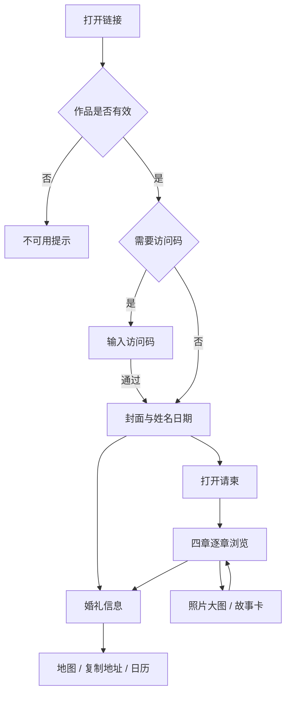

# 花园来信 · 立体婚礼邀请函 PRD

| 文档信息 | 内容 |
| --- | --- |
| 版本 | v1.0 |
| 日期 | 2026-11-04 |
| 状态 | 开发需求初稿；原创美术、交互样品与性能指标待实物验收 |
| 产品形态 | 新人分享给亲友的网页立体婚礼邀请函 |
| 服务模式 | 工作室录入及设计，新人核对，亲友通过链接浏览 |
| 首发主题 | 花园来信，暂定名称 |
| 依据 | [产品方向](../产品方向.md)、[MVP 方案](MVP方案-v1.md)、用户选定的八张 Pinterest 参考 |

本文定义首版开发与验收要求。用户已确认产品用途和参考图；本文新增的默认值、交互参数和服务规则为实施基线，可在样品验证后通过版本记录调整。文档完成不代表功能已实现。

## 1. 产品目标

制作一册可打开、合拢、旋转和逐章翻阅的立体婚礼书。书中包含水彩场地、植物纸雕、新人插画、故事与照片，宾客可以随时查看婚礼时间和地点。

首版交付：一套可复用主题、一个封面、四个立体章节、一个受控的工作室制作入口，以及每份作品的独立链接和分享封面。

### 1.1 用户与任务

| 用户 | 主要任务 | 成功表现 |
| --- | --- | --- |
| 新人 | 提供资料、核对内容、向亲友发送邀请 | 内容正确，愿意分享，修改后原链接仍可用 |
| 宾客 | 看邀请、了解新人、查时间地点 | 无需注册，能直接找到婚礼信息，手机操作清楚 |
| 工作室 | 制作、预览、发布和维护作品 | 第二份作品通过填内容与替换资产完成，标准订单无需改源码 |

### 1.2 首版验证目标

| 目标 | 验证方法 | 达标条件 |
| --- | --- | --- |
| 视觉方向成立 | 实际手机观看封面和第一章，记录用户对画风及动作的反馈 | 用户接受原创样品；程序测试不代替视觉接受 |
| 邀请任务清楚 | 5 位首次使用者从链接进入，无讲解找婚礼信息 | 至少 4 人在 10 秒内找到日期、时间及完整地点 |
| 可以重复交付 | 制作两份内容不同的示例作品 | 共用模板和代码，资料与链接相互独立 |
| 制作成本可控 | 记录标准订单编辑、裁剪及检查耗时 | 首轮目标 30–60 分钟，不含重绘、客户等待及额外修改 |
| 有付费价值 | 样品通过后进行 5 笔付费试单 | 记录付款、完成交付、购买理由和每单实际工时 |

这些是验证目标，不是已经取得的结果或销量承诺。

## 2. 版本范围

P0 为本次可售 MVP 必须完成的需求。P1 为后续增量。C 为有外部条件才交付的能力。

| ID | 需求 | 级别 | 范围 |
| --- | --- | --- | --- |
| F01 | 封面与入口 | P0 | 姓名日期、开书、直接查看婚礼信息 |
| F02 | 书体交互 | P0 | 开合、四章旋转、前后翻阅、有限视角变化 |
| F03 | 四章内容 | P0 | 邀你入园、一路走来、我们的片刻、婚礼见 |
| F04 | 照片 | P0 | 0–6 张，上传、裁剪、排序、删除及大图 |
| F05 | 婚礼信息 | P0 | 日期时间、场地地址、地图链接、复制地址、日历文件 |
| F06 | 音乐 | P0 | 一首预设音乐，默认静音、主动开启、失败重试 |
| F07 | 分享 | P0 | 稳定链接、独立封面、复制链接、保存图片 |
| F08 | 手机与备用展示 | P0 | 微信访问、竖屏、简化 3D、静态章节 |
| F09 | 访问与生命周期 | P0 | 草稿、预览、凭链接访问、可选访问码、撤回和到期 |
| F10 | 工作室制作 | P0 | 管理员登录、作品列表、内容表单、裁剪及校验 |
| F11 | 发布与恢复 | P0 | 发布版本、草稿隔离、原链接更新、恢复上一版 |
| F12 | 运行记录 | P0 | 必要错误及体验事件，支持排查问题和试单复盘 |
| C01 | 微信自定义分享卡片 | C | 账号权限、域名和签名条件核验后接入，并在收件人手机验收 |
| P101 | 出席回执 RSVP | P1 | 是否出席、人数、留言及导出 |
| P102 | 买家自助编辑与支付 | P1 | 订单验证后评估 |
| P103 | 新主题 | P1 | 宝宝、宠物或其他婚礼风格 |

首版场景及机关固定。精确人物肖像、真实场地重绘、新增章节和新机关按额外定制评估。通用产品不包含自由搭景、视频上传、无限照片或任意视角的 360° 观看。

## 3. 美术与纸艺要求

### 3.1 已选参考与用途

| 参考 | 首版采用的设计语言 | 原帖 / 本地图 |
| --- | --- | --- |
| P01 庄园在书中立起 | 水彩建筑、异形纸边、折叠支撑、接触阴影 | [原帖](https://www.pinterest.com/pin/229331806018354980/) · [图片](../research/2026-11-04-pinterest/images/A06.jpg) |
| P04 一套会展开的花园 | 连续水彩地景和故事时刻 | [原帖](https://www.pinterest.com/pin/188658671877604479/) · [图片](../research/2026-11-04-pinterest/images/A15.jpg) |
| P05 草地里藏着新人 | 深绿草地、开窗、人物揭晓 | [原帖](https://www.pinterest.com/pin/804948133441915784/) · [图片](../research/2026-11-04-pinterest/images/B08.jpg) |
| P08 森林层层退后 | 前中后景与开窗纸层 | [原帖](https://www.pinterest.com/pin/1125968650339995/) · [图片](../research/2026-11-04-pinterest/images/C18.jpg) |
| P09 花叶展开的婚礼卡 | 花叶、姓名牌、少量金色与细线 | [原帖](https://www.pinterest.com/pin/6755468186533680/) · [图片](../research/2026-11-04-pinterest/images/A10.jpg) |
| P11 掌心中的舞台 | 有厚度的台口、侧翼和人物站位 | [原帖](https://www.pinterest.com/pin/542754192616287612/) · [图片](../research/2026-11-04-pinterest/images/F15.jpg) |
| P12 童话舞台的层次 | 连续拱门、中央通道与景深 | [原帖](https://www.pinterest.com/pin/623467142197447184/) · [图片](../research/2026-11-04-pinterest/images/F16.jpg) |
| P24 文字沿着纸层展开 | 压花、纸框、沿轮廓布置的短文字 | [原帖](https://www.pinterest.com/pin/449656344054558241/) · [图片](../research/2026-11-04-pinterest/images/C24.jpg) |

主画风由 P01、P04、P05 决定。其余参考用于空间和装饰，统一成同一套花园植物、笔触和光线。正式资产需原创制作或取得使用授权，参考图片保留为设计依据。

### 3.2 画面基线

- 配色候选：暖米白 `#F4EBDD`、森林绿 `#234536`、鼠尾草绿 `#7C8D73`，少量暖玫瑰 `#BD7770` 与旧金 `#AF9564`。最终以原创样稿为准。
- 纸片有可辨认的切边、厚度、折线及柔和投影。人物、建筑和植物共享笔触及光向。
- 新人为自然比例插画，首版使用预设姿态。照片作为照片放进纸框，不自动改写人脸。
- 每章围绕一个主体构图，初步规划 5–7 个景深层。细节优先集中在主要观看区域。
- 姓名、日期和地址以清楚的网页文本显示；装饰文字可沿纸框排列。客户文字必须可替换。
- 首章场景中新人和场地占据主要位置。通用花园不宣称还原客户真实场地；演示建筑标明为示例。

### 3.3 素材交付要求

每个资产须提供独立文件、统一命名和来源记录。纸片还需标注轮廓、前后顺序、折轴、展开角度及支撑关系。

| 资产 | 首版交付 |
| --- | --- |
| 书体 | 封面、封底、书脊、四个扇区、纸纹及边缘 |
| 场景 | 四章独立布局；建筑、新人、植物、拱门和纸框分层 |
| 照片版式 | 竖图 4:5、横图 3:2 两种裁剪框；满图查看保留原始比例 |
| 备用画面 | 四章静态插画，动态姓名、照片和文字由同份数据填充 |
| 分享图 | 1200×1600 主封面、600×600 缩略图；尺寸为本产品输出规格 |
| 检查图 | 封面、正面展开、斜侧面、半开状态和手机尺寸截图 |

## 4. 页面与入口

路径为逻辑约定，最终路由可以等价实现。

| 页面 | 路径示意 | 访问者 | 必备内容 |
| --- | --- | --- | --- |
| 演示作品 | `/demo` | 任何人 | 虚构资料及明确的示例标识 |
| 正式作品 | `/i/:slug` | 凭链接或验证访问码的宾客 | 封面、四章、信息、音乐和分享 |
| 客户预览 | `/preview/:token` | 持有有效预览链接的新人 | 指定预览版本、预览标识、只读 |
| 不可用状态 | 原作品路径 | 访问者 | 链接无效、已撤回或已到期的简短提示 |
| 管理员登录 | `/studio/login` | 工作室 | 账户验证、失败反馈 |
| 作品列表 | `/studio` | 管理员 | 标题、状态、未发布修改、到期日及操作 |
| 编辑作品 | `/studio/projects/:id` | 管理员 | 内容、照片、预览、发布记录 |

### 4.1 宾客主流程

访问受保护作品时，验证成功后才展示姓名、日期、照片和内容。通用加载与验证页面不泄露这些资料。

## 5. 宾客端功能需求

### F01 封面与加载

1. 有权限后优先显示姓名、婚礼日期和「婚礼信息」，随后加载 3D。不得让信息等待全部照片、音乐或四章素材。
2. 书体准备好后启用「打开请柬」。未准备好时显示明确的加载状态及「简洁查看」。
3. 请求超过 8 秒显示重试入口；仍可使用已经取得的婚礼信息。完全未取得数据时显示连接失败，不展示虚构内容。
4. 首次进入停在封面。刷新回封面；照片弹窗关闭、信息面板关闭及返回前台保留当前章。
5. 首次展开目标 2–3 秒，提供「跳过动画」，跳到合法的第一章稳定状态。

### F02 书体、翻阅与手势

书体为四扇区环形立体书。翻阅指沿书脊转动到相邻扇区，前后章节保持真实空间关系。开合时纸片绕预设折轴运动，并随书页收拢。

| 输入 | 行为 |
| --- | --- |
| 点击打开 | 从封面展开至第一章 |
| 点击上一章 / 下一章 | 移动一章并对准正面，目标 0.8–1.2 秒 |
| 场景内横向拖动 | 小幅度预览纸层；达到阈值后释放，切换相邻章 |
| 未达到阈值释放 | 返回当前章的默认视角 |
| 纵向滑动 | 保留页面滚动，不触发章节切换 |
| 点击合上 | 纸片及书页收回，返回封面；目标 1.5–2.5 秒 |
| 点击章节进度 | 切换到指定章；最多四项 |
| 键盘 | 焦点在书体控件时，左右键翻章，Enter 激活按钮；Esc 关闭面板 |

初始手势参数：移动超过 8 CSS px 后区分点击与拖动；横向位移大于纵向的 1.3 倍才锁定翻章；翻章阈值为场景宽度的 20%，限制在 48–96 CSS px。参数可依据真机调整，变更需记录。第一章的上一章禁用，第四章的下一章改为「合上请柬」，不循环跳回第一章。

小幅预览限制左右偏转约 ±12°、俯仰约 ±5°；不得进入书底或不可阅读背面。照片大图、故事卡及信息面板打开时暂停书体手势。

动画状态为 `closed / opening / reading / turning / closing`。动画中只保存最后一个合法目标，最多一项；关闭、跳过和进入静态模式可取消待执行目标。快速点击不得无限排队。后台暂停后返回时恢复或直接落到目标稳定姿态，不重播整段开场。

### F03 四章内容

| 章节 | 内容与动作 | 内容缺失处理 |
| --- | --- | --- |
| 邀你入园 | 建筑与花园立起，新人出现；显示姓名、日期、地点简名、邀请短句；点姓名牌打开邀请全文 | 必填字段缺失阻止发布 |
| 一路走来 | 最多三段地景与纸签；点纸签显示日期、标题和故事正文 | 零故事时使用经工作室确认的通用短句与花园插画，不虚构相识经历 |
| 我们的片刻 | 开窗纸层包围当前照片，展示数量和说明；前后切换，可点大图 | 零照片时为插画与新人短句；一张时隐藏前后切换 |
| 婚礼见 | 花架、拱门和新人构成舞台；点邀请卡打开完整信息 | 无流程时隐藏流程区，保留时间地点 |

每章有可选动作提示。邀请信息不能依赖找到隐藏机关。四章标题首版固定，文案和照片可编辑。

### F04 照片浏览

- 使用发布版本中的裁剪结果展示纸框缩略图，点击后显示处理过的完整比例图片。
- 大图提供前后、关闭和张数提示；图片说明可换行。竖向滚动说明不触发书体翻页。
- 支持图片自然缩放查看；关闭后回到同章同张。
- 图片加载失败显示纸框占位与「重试图片」，其他内容照常使用。
- 禁止页面后台一次加载全部原始大图；原始上传文件不作为宾客浏览资源。

### F05 婚礼信息

封面及四章均提供可见的「婚礼信息」入口。面板显示新人姓名、当地婚礼日期、开始时间、可选结束时间、场地名、完整地址和可选流程。

| 操作 | 规则 | 失败处理 |
| --- | --- | --- |
| 查看地图 | 使用工作室核对的 HTTPS 地图链接；不自动猜测场地 | 地址始终可见，提供复制地址 |
| 复制地址 | 复制场地名和完整地址；成功后明确提示 | 显示可选择文本及手动复制说明 |
| 添加日历 | 生成 `.ics` 文件；开始时间、可选结束时间、地点及作品链接来自同份数据 | 文件无法直接导入时说明可保存后打开，继续显示时间地点 |

日历使用事件设定的时区，不能随宾客设备时区改写原始婚礼时间。缺少结束时间时不编造活动时长。每份作品使用稳定事件 UID，发布更新提高版本序号；界面不承诺已导入的日历会自动更新。

演示作品标注虚构地点并隐藏无实际目标的地图按钮。正式发布需具备经检查的地图链接。

### F06 音乐

默认静音。宾客点击开启后发起播放，按钮状态以实际播放结果为准。暂停后同次浏览保持暂停；重新打开链接仍默认静音。

播放失败提示「音乐暂时无法播放，可点击重试」，不阻塞开书。进入后台暂停，返回前台不突然恢复有声播放。关闭作品停止播放。首版可由工作室选择预设曲目或关闭音乐，不提供买家音乐文件上传。

### F07 分享

- 正式作品使用稳定随机链接，内容修改不改变链接。
- 提供「复制链接」「保存封面」。复制失败展示可选文本；微信内无法下载时展示图片及长按保存说明。
- 分享封面用专门版式输出，不直接使用含操作按钮的屏幕截图。生成前可预览姓名、日期与裁切。
- 普通作品的封面可以包含客户确认的姓名和图片；访问码作品默认使用通用花园封面，公开标题不带私人信息。
- 对外标题、描述、封面均来自已发布版本；预览链接不提供正式分享入口。
- C01 单独记录是否可用。链接转发成功和自定义卡片生效分别检查，以收件人看到的标题及缩略图为准。条件不具备时交付链接与封面，并明确本版未交付自定义卡片。

### F08 手机与备用展示

手机竖屏一次展示一幕。场景初步占可用高度 55%–65%，操作和短文案占其余区域；小屏可滚动，避免强制固定高度截断内容。

| 模式 | 画面 | 进入条件 |
| --- | --- | --- |
| 完整 3D | 完整纸层、柔和阴影、开合及转章 | 默认尝试 |
| 简化 3D | 保留主体和纸层，降低像素比、阴影及装饰 | 动画期间持续性能不足 |
| 静态章节 | 同画风插画、动态文字和照片，前后阅读 | 用户主动选择、减少动画偏好、WebGL 失败或持续卡顿 |

只在动画期间采集帧率判断性能，静止时不以低帧率判定故障。初始规则：连续两个有效的 2 秒动画窗口低于 24 fps，降一级；简化后仍不达标进入静态模式。同次浏览不自动反复升降级，用户可手动重新尝试 3D。

静态模式保留四章、照片、故事、信息、音乐和分享。切换后保持当前章。支持减少动画设置；主要文本可被辅助工具读取，按钮有文字名称和可见焦点。

## 6. 工作室制作与发布

### F09 访问和状态

管理员首版只有工作室一个角色；无公开注册。新人使用只读预览链接，宾客只访问已发布作品。

| 状态 | 宾客正式链接 | 管理员 | 新人预览 |
| --- | --- | --- | --- |
| 草稿 | 不可读取内容 | 编辑、生成预览 | 持有效预览链接看指定版本 |
| 已发布 | 读取当前发布版；按配置验证访问码 | 编辑独立草稿、发布更新、撤回 | 持有效预览链接看指定版本 |
| 已撤回 | 显示不可用，不返回内容及媒体 | 可编辑、恢复发布 | 有效预览仍可用于核对 |
| 已到期 | 显示已到期，不返回内容及媒体 | 可延长期限后恢复 | 有效预览仍可用于核对 |

作品状态与「有未发布修改」分开记录。到期时间先于或等于当前时间时，正式入口立即不可用。重新发布不能自动清除到期限制。

预览链接对应一次不可变的预览快照，默认 7 天有效，可提前撤销或重新生成；编辑草稿不会悄悄改变客户正在核对的版本。预览页显示「预览稿」及版本号。更换预览链接应使旧链接失效。

访问码初版为 6–12 位字母或数字，可由工作室随机生成并另行告知。由服务端验证，失败 5 次后冷却 60 秒，限制至少覆盖作品和请求来源；通过后发放最长 24 小时会话，且不超过作品到期时间。修改访问码、撤回及到期使会话无效。响应不包含明文访问码。

所有非公开原始照片、预览素材和受访问码保护的媒体必须验证权限。受保护资源不进入公开缓存；用于交付的临时媒体地址有效期不超过 5 分钟。撤回阻止新授权，已签发地址最多在有效期内可用，已下载内容无法远程收回。

### F10 管理员操作

作品列表至少显示：内部作品名、新人姓名、作品状态、未发布修改标识、更新时间、到期日。可新建、复制、编辑、预览、发布、撤回及进入发布记录。

编辑页分为「基本信息」「故事」「照片」「访问与分享」四组。每组显示完整验证提示，错误定位到字段。首版采用明确的「保存草稿」按钮；存在未保存修改时，离开页面提示保存或放弃。

保存成功显示时间。保存失败保留输入，允许重试。多人或多标签同时编辑时检测修订版本冲突，阻止静默覆盖，提示刷新或保留当前输入另行处理。

复制作品生成新 ID 和新链接。只复制主题、版式与可复用装饰，默认清空客户姓名、时间地址、照片、访问码、到期时间和预览链接；不把客户资料带入下一单。

### F04 照片制作规则

1. 接受 JPEG、PNG、WebP，单文件上限 20 MiB、解码像素上限 4000 万；检查实际文件内容和解码结果。HEIC 等不支持格式给出转换提示。
2. 按原始方向信息纠正旋转；裁剪工具支持移动、缩放、90° 旋转，明确显示最终纸框边界。
3. 根据选择的竖图 4:5 或横图 3:2 保存裁剪参数，参数基于旋转后的图像；更换原图必须重新确认裁剪。
4. 裁剪参数采用归一化 `x / y / width / height`，范围在 0–1，裁剪区域必须完全落在图像内。
5. 输出纸框图、浏览大图及必要的小图，不向宾客发送相机原文件；移除不必要的 EXIF 数据。
6. 上传失败可逐张重试。第七张明确提示最多六张；上传及处理中素材不计作可发布资产。
7. 重排仅改变展示顺序。删除草稿照片不破坏当前发布版或有效预览快照使用的资产。

### F11 发布与恢复

流程：保存草稿 → 内容及资产检查 → 生成预览快照 → 新人核对 → 管理员记录核对完成 → 发布。

发布前展示姓名、日期时间、地点地址、照片数量、访问模式、有效期和公开封面。以下条件阻止发布：必填项缺失或超限、日期时间无效、正式作品无地图链接、照片未处理完、分享图或静态资产缺失、未完成本版核对。

所有核对记录绑定草稿修订号；之后修改姓名、时间、地址、照片或访问模式会清除该修订的核对标记。

发布生成完整快照，包含内容、素材引用、模板版本和分享图。全部准备成功后一次切换到新版本；失败保持原发布版，显示可重试原因。重复点击或网络重试不能产生多个重复发布版本。

宾客本次进入使用同一版本完成阅读；刷新或重新打开读取最新版，避免阅读中途姓名、照片和场地来自不同版本。

保留当前版及上一发布版用于恢复。恢复时重新发布旧内容快照，但保留当前访问码、撤回状态和有效期等访问设置，避免恢复旧权限。恢复同样需要核对。

默认在线期限候选为首次发布起 12 个月，管理员发布前确认具体到期日。内容更新、恢复旧内容及访问码修改不重置期限。订单维护期限需在售卖前确认，不作为永久托管承诺。

## 7. 内容字段与校验

文本均按纯文本处理，不接受 HTML 或脚本。字符上限按用户可见字符计算，去掉首尾空白；不通过缩成极小字体或省略号隐藏必填内容。

| 字段 | 必填 | 约束 / 默认 |
| --- | --- | --- |
| 内部作品名 | 是 | 1–40 字，只在工作室显示 |
| 新人 A 姓名、新人 B 姓名 | 是 | 各 1–12 字；不由字段名强制性别 |
| 婚礼日期 | 是 | 有效日历日期；过去日期提示核对，纪念作品可保留 |
| 开始时间 | 是 | 24 小时制，精确到分钟 |
| 结束日期及时间 | 否 | 成组填写，必须晚于开始；支持跨日 |
| 时区 | 是 | 工作室明确选择 IANA 时区，示例模板使用 `Asia/Shanghai` |
| 场地名 | 是 | 1–40 字 |
| 场地简名 | 否 | 最多 16 字，用于首章；未填则场地名自然换行 |
| 完整地址 | 是 | 1–120 字；信息面板允许换行 |
| 地图链接 | 正式作品是 | HTTPS、长度不超过 2048 字符；工作室核对落点；演示作品可空 |
| 邀请短句 | 是 | 1–60 字，允许换行 |
| 邀请全文 | 否 | 最多 200 字；为空时展示短句 |
| 故事节点 | 否 | 0–3 个，每项标题 1–12 字、正文 1–80 字、日期可选 |
| 零故事备用文案 | 是 | 最多 60 字，默认通用邀请表达，工作室可修改 |
| 照片 | 否 | 0–6 张；每张说明最多 40 字 |
| 零照片短句 | 是 | 最多 60 字，搭配插画版回忆页 |
| 婚礼流程 | 否 | 0–4 项；每项时间、标题 1–16 字，说明最多 40 字 |
| 音乐 | 是 | 预设曲目 ID 或关闭 |
| 访问方式 | 是 | 凭链接 / 访问码，默认凭链接 |
| 到期时间 | 发布时是 | 必须晚于发布时间；显示事件时区并保存明确时间点 |
| 分享标题 | 是 | 最多 36 字，受保护作品默认通用标题 |
| 分享描述 | 否 | 最多 60 字 |
| 公开封面方案 | 是 | 通用插画 / 已确认的定制封面 |

模板 ID、模板版本、数据版本、作品 ID、随机链接标识、修订号、发布号、创建更新时间由系统维护。凭链接访问仅表示持有链接者可看；搜索引擎索引设置不承担访问控制。

## 8. 组件与数据约束

技术建议延续 MVP 方案：TypeScript、React / Next.js、Three.js / React Three Fiber、关系型数据库与对象存储。具体依赖版本在开发启动时核验并锁定，本 PRD 不绑定未经验证的版本号。

| 组件 / 数据 | 必须承担的责任 |
| --- | --- |
| 书体引擎 | 开合、扇区旋转、相机、动画状态，不包含具体客户资料 |
| 纸艺场景 | 轮廓、纸边、层次、折轴及投影，可由主题配置 |
| 主题模板 | 四章布局、可替换槽位、插画与静态布局 |
| 作品草稿 | 当前编辑内容、裁剪参数及修订号 |
| 预览快照 | 指定修订的只读内容、有效期和撤销状态 |
| 发布快照 | 内容、模板版本、分享图及全部资产引用，发布后不可原地改写 |
| 素材记录 | 原图、派生图、处理状态、访问范围和版本引用 |
| 访问记录 | 访问方式、访问码摘要、会话版本、撤回与到期设置 |

作品所有展示模式使用同一份内容。日期不能在 3D、信息面板、分享图、日历四处分别手填。旧作品绑定可用模板版本，升级模板不得直接改变已交付作品。

照片、故事及访问码均在服务端校验。客户端代码和公开配置不含管理员凭据、访问码明文或第三方密钥。地图链接仅接受允许的 HTTP(S) 目标协议，正式发布要求 HTTPS；点击外部链接不泄露预览或访问令牌。

## 9. 异常状态与提示

| 情况 | 用户看到什么 | 恢复方式 |
| --- | --- | --- |
| 链接不存在 | 这份请柬暂时无法访问 | 检查链接或联系发送者 |
| 访问码错误 | 访问码不正确，请重新输入 | 重新输入；达到次数限制后显示倒计时 |
| 预览失效 | 预览链接已失效，请向工作室获取新链接 | 管理员生成新预览 |
| 已撤回 | 这份请柬暂时无法访问 | 联系发送者，不展示原内容 |
| 已到期 | 这份请柬已到期 | 联系发送者，不展示原内容 |
| 网络超时 | 加载较慢，可重试或简洁查看 | 重试；已载入信息保留 |
| 3D 初始化失败或上下文丢失 | 自动进入静态章节，可提示已切换简洁查看 | 保持同章，可手动重试 3D |
| 照片失败 | 纸框占位和重试图片 | 单张重试，不重启书体 |
| 音乐拒播 | 音乐暂时无法播放 | 再次点击播放 |
| 保存失败 | 保存失败，当前输入已保留 | 重试或复制当前内容 |
| 编辑冲突 | 内容已在其他窗口更新 | 查看最新版本后重试，禁止直接覆盖 |
| 发布失败 | 发布未完成，线上仍为上一版 | 修复后重试 |
| 无法复制或下载 | 显示可选择文本或封面图片 | 手动复制或长按保存 |

报错文案不直接向宾客暴露堆栈、数据库信息、原始文件路径或内部账号。

## 10. 非功能要求

### 10.1 性能预算

以下为首轮目标，须记录实测值。测试条件为冷缓存、10 Mbps 下行、100 ms 延迟，并记录真实机型、系统与浏览器版本。

| 指标 | 首轮目标 | 统计口径 |
| --- | --- | --- |
| 姓名日期可读 | 2 秒内 | 从导航开始到内容可读；访问码页从验证成功计时并单列验证耗时 |
| 首章可打开 | 5 秒内 | 从导航开始到开书入口可用且动作可执行 |
| 首章资源 | 不超过 3 MB | 到首章可操作前的压缩传输总量，包含所需 JS、字体和贴图 |
| 全书必要资源 | 不超过 8 MB | 四章模板、程序与必需字体；客户照片及音乐单列统计 |
| 动画流畅度 | 中档测试机平均至少 30 fps | 开合及转章各运行 10 次，记录平均值与长卡顿 |
| 静止场景 | 按需渲染 | 无交互无动画时不持续刷新 3D |

照片和音乐按需加载；同时记录解码后纹理占用及持续浏览结果。首屏预算无法达成时优先压缩资产、减少同时加载内容，不能静默取消备用展示或关键信息。

### 10.2 设备与操作

- 至少一台 iPhone 和一台中档 Android 真机；分别测试微信，并补充 Safari / Chrome。
- 竖屏覆盖 360、390、430 CSS px；桌面覆盖常见 1280 px 以上布局；小高度窗口允许滚动。
- 横屏可调整布局或展示友好提示，但信息仍可访问，不要求强制旋转设备。
- 主要触控区域至少 44×44 CSS px，正文基准 16 px；不依赖悬停或设备陀螺仪完成操作。
- 面板打开时焦点进入面板，关闭后回到触发控件；保留键盘和辅助阅读路径。
- 所有必需资源随部署提供，不依赖 Pinterest 原图链接或外部字体即时加载。

### 10.3 运维与数据维护

记录发布和恢复结果；上线前验证数据库及素材可恢复。删除素材时先检查发布版、上一版和有效预览的引用，避免误删仍在使用的文件。

客户要求删除作品时，先撤回并吊销预览和会话，再由工作室执行内容及个人素材清理。首版可由受控运维流程完成，不需要开发批量删除后台。备份保留期限及删除流程在正式托管方案确定时补齐。

## 11. F12 埋点与试单记录

| 事件 | 最少字段 | 用途 |
| --- | --- | --- |
| `invitation_loaded` | 作品 ID、发布号、展示模式、加载耗时 | 观察是否成功打开 |
| `book_opened` | 作品 ID、展示模式 | 观察是否打开书 |
| `chapter_viewed` | 作品 ID、章节号 | 观察阅读进度 |
| `info_opened` | 作品 ID、来源章节 | 验证信息入口 |
| `photo_opened` | 作品 ID、照片槽位编号 | 观察照片浏览 |
| `map_clicked` | 作品 ID | 仅表示点击，不表示导航成功或已到场 |
| `fallback_entered` | 作品 ID、原因码、原模式 | 排查兼容与性能 |
| `runtime_error` | 发布号、模板版本、错误码 | 定位故障 |

业务事件不采集宾客姓名、访问码、照片内容或含令牌的完整 URL。不建立跨作品用户画像；同次页面访问中的重复章节曝光去重，报表称访问或会话，不声称独立人数。埋点失败不能阻塞请柬。

工作室另记录每单资料齐备时间、制作时间、修改次数、重绘时间、来源、报价及实际交付结果。未完成自定义分享接入时，不显示“分享成功次数”等无法确认的指标。

## 12. 验收用例

| 用例 | 关联需求 | 操作 / 数据 | 通过条件 |
| --- | --- | --- | --- |
| AC01 | F01、F03 | 冷启动正式链接 | 姓名日期优先显示，信息可直达；内容正确 |
| AC02 | F02 | 连续开合 10 次，检查半开及斜侧 | 无穿模、闪烁、漂浮纸片或姿态残留 |
| AC03 | F02 | 连续快速点翻章、反向拖动、合上及跳过 | 最多一个待执行目标，最终状态正确 |
| AC04 | F02、F04 | 弹窗内翻照片、纵向滚动、关闭 | 不误触书体，返回原章原照片 |
| AC05 | F03、F04 | 零故事、零照片、一张、六张 | 无空洞占位、假故事或越界按钮 |
| AC06 | F04、F10 | 横竖图、带旋转信息图片、超限及坏文件 | 裁剪预览与成品一致，错误可重试且不影响其他素材 |
| AC07 | F05 | 长姓名、长地址、跨日结束时间及不同时区 | 无截断，网页和日历一致，地图落点人工核对通过 |
| AC08 | F06 | 无手势、开启、暂停、拒播、后台返回 | 默认静音，状态与实际播放一致，无突然恢复声音 |
| AC09 | F07、C01 | 两部手机收取链接与封面 | 链接可用、封面正确；自定义卡片单独记录支持结果 |
| AC10 | F08 | 禁用 WebGL、触发上下文丢失、低帧及减少动画 | 转入可用静态版，同章同数据，信息完整 |
| AC11 | F09 | 未验证直接请求受保护内容和图片 | 拒绝读取；通过验证后可用；访问码变更使会话失效 |
| AC12 | F09 | 到期、撤回、失效预览、媒体地址过期 | 状态提示正确；新请求及过期媒体地址不可读取 |
| AC13 | F10、F11 | 保存草稿、新人核对后再次修改、发布失败 | 线上不受草稿影响；修改重置核对；失败保留旧版 |
| AC14 | F11 | 网络重试发布、恢复旧版、两个窗口编辑 | 无重复发布及静默覆盖，恢复不回退访问设置 |
| AC15 | F10 | 复制并制作第二份作品 | 不复制客户私有资料，代码共用，作品互不影响 |
| AC16 | 全部 P0 | 真机完整浏览、切后台、弱网及重开 | 没有阻断邀请任务的故障，记录机型与版本 |
| AC17 | F01、F05 | 5 位首次使用者寻找日期时间地点 | 至少 4 人 10 秒内完成，无需口头提示 |
| AC18 | 美术 | 与八张参考对照实际手机样品 | 用户接受画风、纸层、人物及运动；保留反馈记录 |

上线前 AC01–AC16 的适用 P0 用例必须通过。C01 不具备条件时明确标记本版未交付，并验证链接与封面路径。AC17 暴露的任务障碍须修复，AC18 单独取得实际样品反馈。

不得用桌面模拟截图替代真机记录，或用单张漂亮效果图代替开合与翻阅验收。

## 13. 里程碑与交付物

| 阶段 | 工作 | 完成时必须留下的成果 | 估算投入 |
| --- | --- | --- | --- |
| M1 | 封面及第一章美术 | 分层资产、正面/斜侧/半开画面、手机构图 | 3–5 工作日 |
| M2 | 第一章实际交互 | 可打开的网页、开合旋转、真机录屏及性能记录 | 3–5 工作日 |
| M3 | 完整四章 | 照片、故事、信息、音乐及静态版本 | 5–7 工作日 |
| M4 | 工作室交付 | 录入裁剪、预览、版本发布、访问控制，两份不同示例 | 4–6 工作日 |
| M5 | 上线试用 | 真机验收、使用者反馈、故障修复与交付说明 | 3–5 工作日 |

合计 18–28 个投入工作日，按全职约 4–6 周；完成 M2 后重新估算。美术返修、账号准备及客户反馈等待会改变实际日历工期。

第一阶段使用明确标记的虚构新人和示例场地推进，不等待真实订单资料。对外样品录屏必须来自实际运行版本。

## 14. 待验证事项与处理原则

| 事项 | 何时确定 | 当前执行方式 |
| --- | --- | --- |
| 最终配色、人物画法、纸层密度 | M1 样稿 | 按本 PRD 的候选画风制作，依据实际反馈调整 |
| 开合细节和手势参数 | M2 手机样品 | 按初始参数实现，记录调整 |
| 微信账号、自定义卡片权限及域名 | M4 前 | 可先完成链接、封面和接入边界，不宣称已支持 |
| 托管区域、存储、备份与维护期限 | M4 前 | 先做可配置部署；正式承诺前确认实际成本和可用性 |
| 目标真机型号 | M2 前 | 选定可取得的 iPhone 与中档 Android 并记录 |
| 定价及场地/肖像加项 | M2 样品后 | 根据实测制作耗时决定，不把旧报告价格当作已验证售价 |

## 15. 版本记录

| 版本 | 日期 | 变化 |
| --- | --- | --- |
| v1.0 | 2026-11-04 | 将八张已选参考与 MVP 方案转成需求编号、页面流程、交互规则、字段、权限状态及验收用例 |

